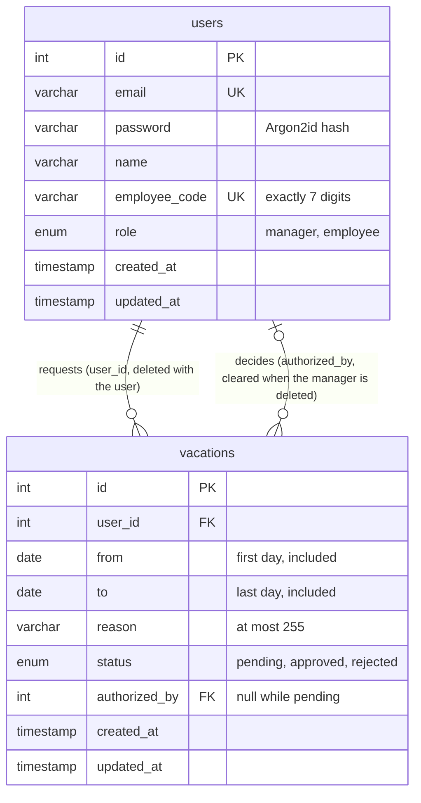

# Vacation Portal

Please review the [Assignment](Assignment.md) document for the detailed business requirements of this assignment.

## Getting Started

1. **Environment Setup**
   - Copy the example environment file to create your own configuration:
     ```sh
     cp .env.example .env
     ```
   - Edit `.env` and update the values as needed for your local setup.
   - For a standard Docker setup, copying `.env.example` as-is is enough.
2. **Project Lifecycle Commands**
  - Use the provided `run` script to manage the project:
    - **Build the project (install dependencies, migrate, seed):**
      ```sh
      ./run build
      ```
    - **Start the project:**
      ```sh
      ./run start
      ```
    - **Stop and remove containers and volumes:**
      ```sh
      ./run teardown
      ```
    - **Run backend checks:**
      ```sh
      ./run check-be
      ```
    - **Run frontend checks:**
      ```sh
      ./run check-fe
      ```
    - **Run QA / Cypress checks:**
      ```sh
      ./run check-qa
      ```

You will need to first execute the `./run build` command before starting the project for the first time. Then you can
use the `./run start` command to start the project. The `./run teardown` command can be used to stop and remove all
containers and volumes (clean-up). Finally, while the project is running, you can use the `./run check-xx` command to
run the automated checks.

3. **You can now visit the URL**: `http://localhost:5173` and access the project.

The following test users can be used to log in:

| Role     | Email                  | Password         | Name          |
|----------|------------------------|------------------|---------------|
| Manager  | manager@example.com    | managerpass123   | Manager User  |
| Employee | employee@example.com   | employeepass123  | Employee User |

4. **Manually testing the API**
   - Example login request:
     ```sh
     curl -v -X POST http://localhost:8080/auth/login \
       -H "Content-Type: application/json" \
       -d '{"email": "manager@example.com", "password": "managerpass123"}'
     ```
   - Alternatively you can use the `./test_routes.sh` script inside the `be` folder to test all the API routes.

Refer to the `run` script for more details on each command.

## Troubleshooting

- **Login returns a 500 right after `./run build`.** Almost always a MySQL
  init race, not a bug in your code: the db container can report healthy
  before its entrypoint finishes creating the app database and user, so the
  backend starts against a half-initialized database (look for
  `Access denied for user 'vacation'@'...'` in the `vacation_be` logs).
  Fix by rebuilding from a clean state:
  ```sh
  ./run teardown && ./run build
  ```
  The same `Access denied` error appears if you change `DB_USERNAME` or
  `DB_PASSWORD` in `.env` after the database was first created: MySQL only
  applies those values when it initialises an empty volume. Run
  `./run teardown` (which deletes the database volume) before building again
  whenever you change them.

### Runbooks (local environment)

Short, step-by-step procedures for situations that come up while working on
the project. Commands assume a POSIX shell (Git Bash on Windows).

**Reset to a clean state** (all data is deleted and the two test users are
re-seeded)

1. `./run teardown` removes the containers and the database volume.
2. `./run build` rebuilds the images, runs the migrations and the seed, then
   stops the stack.
3. `./run start` starts it again.
4. Check: <http://localhost:5173> loads and `manager@example.com` can log in.

**Back up the database**

```sh
docker exec vacation_db sh -c 'mysqldump --single-transaction -u"$MYSQL_USER" -p"$MYSQL_PASSWORD" "$MYSQL_DATABASE"' > backup.sql
```

The dump contains personal data and password hashes. Keep it out of git and
out of shared or synced folders.

**Restore the database from a backup** (replaces the current data)

1. Make sure the stack is running (`./run start`).
2. Load the dump:
   ```sh
   docker exec -i vacation_db sh -c 'mysql -u"$MYSQL_USER" -p"$MYSQL_PASSWORD" "$MYSQL_DATABASE"' < backup.sql
   ```
3. Check: log in and confirm the users and vacation requests you expect. A
   backup that has never been restored has not been proven to work, so try
   this once.

**The stack won't start because a port is in use**

The project uses ports 5173 (UI), 8080 (API) and 3306 (MySQL). Stop whatever
holds the port (a local MySQL is the usual cause), or run `./run teardown` if
an earlier copy of this stack is still running, then `./run start`.

**The API returns 5xx errors**

1. `docker logs vacation_be --tail 50` shows the web server output.
2. `docker compose -p vacation-portal ps` shows whether `vacation_db` is up
   and healthy.
3. If the logs mention `Access denied` or an unknown database, follow the
   MySQL init race entry above.

## Design decisions

The assignment leaves several things open. These are the choices made, in plain terms, and why.

| Decision | Why |
|---|---|
| **One authentication path.** A middleware reads the token once, loads the user from the database on every request and hands it to the controller. | Roles come from the database, not from the token, so a deleted or demoted person loses access immediately instead of when their token expires. Controllers no longer each repeat the check. Costs one primary-key lookup per request. |
| **Every error has the same shape and a meaningful status:** 400 invalid input, 401 not signed in, 403 wrong role, 404 not found, 409 conflict with the current state, 500 unexpected (with a generic message). The body is always `{"status_code", "reason_phrase"}`. | The UI can show the server's own message, and the API describes itself. |
| **Input is checked before it reaches a model or the database** (request classes per write endpoint). | No bad input becomes a 500, and the rules are in one place. |
| **Dates are calendar days end to end** (`"2030-07-01"`), and the number of days is computed by the server (both ends included). | Avoids the classic time-zone off-by-one where a date shifts a day for some viewers. |
| **Rules for a new request:** it may not start in the past, may span at most 60 days, and may not overlap another pending or approved request of the same employee. A single day is allowed. | The assignment is silent on these; they are the behaviour an HR tool needs. MySQL has no exclusion constraint, so the overlap check runs in a transaction that first locks the employee's row; two simultaneous submissions are handled one after the other. |
| **A decision is a conditional write** (`UPDATE ... WHERE status = 'pending'`). | Two managers cannot both decide one request: the second gets a 409 and the stored result is unchanged. |
| **Cancelling someone else's request answers 404**, the same as for a request that does not exist. | It does not reveal which ids are in use. |
| **Domain-driven design where it pays.** The vacation context has real behaviour (a request that knows when it can be decided or cancelled, a date range value object, a policy, use cases and a repository interface). Users stays plain CRUD and authentication stays thin. | Matches the effort to where the rules are. The rules can be unit-tested without a database. |
| **Notifications.** A manager sees a badge with the number of pending requests in the navigation (refreshed every minute and when the window regains focus). The employee is emailed when their request is approved or rejected (see below). | "Notify" needs no infrastructure this way. A queue and a real mail provider are the production path. |
| **Manager history** with `GET /vacations?status=pending\|approved\|rejected\|all`, pending by default. | Additive and backward compatible. |
| **The token is kept in `localStorage`.** | The least change for this assignment, with a small cross-site-scripting surface (React escapes output, no raw HTML). Production would use an httpOnly cookie with CSRF protection. |

**Assumptions where the assignment is silent**

- A manager can create other managers (the role is chosen when creating a user). Roles are not editable in the UI, and a manager cannot change their own role or delete their own account.
- Managers decide on requests; they do not make or cancel them (403).
- A rejected request frees its days again; approved and pending ones block them.
- "All associated data is deleted" means a deleted user's vacation requests are deleted with them. Requests that user had *decided* stay, with the decider cleared.

**Deliberately not built**

| Left out | Why, and what it would take |
|---|---|
| Managers seeing only their own reports | There is no organisation structure in the assignment. It needs `users.manager_id` and an authorisation check on list and decide. |
| Leave balances, public holidays, half days | Out of scope; they would be new tables and rules. |
| A real mail provider and a queue | Emails are written to files (see below). Production would write an outbox row in the same transaction as the decision and send from a worker with retries. |
| Pagination, login rate limiting, refresh tokens, single sign-on | Not needed at this size. They are the first things to add as it grows. |
| An audit table | A decided request keeps who decided it (`authorized_by`) and, because it can no longer change, `updated_at` is when. A full history of changes would be an event table. |
| Production images and a deployment pipeline | Described under *Delivery and operations* below, not built. |

## Testing

| Layer | What it covers | How to run |
|---|---|---|
| Backend unit (PHPUnit, PHPStan level max, php-cs-fixer) | Rules, use cases, controllers, repositories with a mocked database, and that the API documentation matches the routes | `./run check-be` |
| Backend integration (PHPUnit, real MySQL) | What mocks cannot show: constraints and foreign keys, cascades, case-insensitive uniqueness, overlap boundaries, strict mode and UTC, the request use case with its lock, and that the migrations roll back and re-apply | see below |
| Frontend (Vitest, Testing Library, ESLint, `tsc`) | Components, pages, who can open which route, the session and the API client. Coverage thresholds are enforced in `fe/vitest.config.ts` | `./run check-fe` |
| End to end (Cypress) | The journeys of both roles through the UI, plus an API-level table of who may call what | `./run check-qa` (the app must be running) |

**Integration tests.** They need their own throwaway MySQL, so they can never touch the development data. The test tooling (the integration test base class and the Phinx `testing` environment) refuses a database whose name does not contain the word `test`, for example `vacation_test`. Without `TEST_DB_HOST` set they are skipped; set `REQUIRE_INTEGRATION_TESTS=1` to make a missing database a failure instead.

```sh
# 1. A disposable MySQL in memory, on the same network as the stack (start it first with ./run start)
docker run -d --rm --name vacation_db_test --network vacation-portal_default --tmpfs /var/lib/mysql \
  -e MYSQL_RANDOM_ROOT_PASSWORD=1 -e MYSQL_DATABASE=vacation_test \
  -e MYSQL_USER=vacation_test -e MYSQL_PASSWORD=vacation_test_pass mysql:8.3

# 2. Apply the migrations, check they roll back and re-apply, and run the tests
docker exec -w /var/www/html/be -e TEST_DB_HOST=vacation_db_test -e TEST_DB_PASSWORD=vacation_test_pass \
  -e REQUIRE_INTEGRATION_TESTS=1 vacation_be sh -c 'composer db:verify-migrations && composer test:integration'

# 3. Remove it
docker stop vacation_db_test
```

## API documentation

The API is described in OpenAPI 3.1, served at <http://localhost:8080/openapi.yaml> (the file is `be/public/openapi.yaml`). It is generated from attributes next to the controllers with `composer build:schema` (run inside the `vacation_be` container). A unit test fails if a route is not documented or if the committed file is out of date.

## Database design and operations



**The database enforces what it can**, so data written by anything other than the application (a script, a manual fix) cannot break the rules:

- `email` and `employee_code` are unique. Email uniqueness ignores case (the column's collation), so `Ada@x.com` and `ada@x.com` are one address.
- `CHECK (from <= to)` on vacations and `CHECK (employee_code REGEXP '^[0-9]{7}$')` on users (MySQL 8.0.16 or later enforces them).
- `role` and `status` are enums, so an unknown value is refused.
- `vacations.user_id` is a foreign key with `ON DELETE CASCADE` (a user's requests go with them). `authorized_by` is `ON DELETE SET NULL` (the history of the employees a manager decided on is kept).
- Every connection runs in UTC with strict SQL mode, so a too-long value is an error instead of being silently cut off, and impossible dates are refused.
- Overlap cannot be a constraint in MySQL, so it is checked by the application inside a transaction holding a lock on the employee's row.

**Indexes** follow the queries. The manager's queue and history read by status and start date (`status, from`), an employee's list and the overlap check read by owner and start date (`user_id, from`). The foreign key on `user_id` uses the same index, so there is no separate one.

**Migrations** are Phinx files in `be/db/migrations`. They are never edited once applied; changes are new files, each one reversible. `composer db:verify-migrations` (against the throwaway database above) migrates, rolls back everything and migrates again.

**Database users.** The application should connect as a user that can only read and write rows, and migrations as one that can change the schema; see *Database users* below. Dates are `DATE` columns (no time zone), moments are stored in UTC.

**Reset, back up and restore** are in the runbooks above. MySQL 8.4 LTS is the version to run in production; the project's Compose file uses 8.3.

## Delivery and operations (proposed design)

The project runs locally with Docker Compose. Nothing is deployed, so this
section describes how it would be operated as an internal tool and the
runbooks that would back it. It is a design, not an implemented pipeline.

**Release flow:** every change goes through a pull request with the automated
checks (`composer check:all`, `npm run validate`, the test suites, and the
Cypress journeys). Merged changes are built into one image per service, tagged
with the git commit, and promoted from staging to production after approval.

**Runbooks the production setup would need**

| Situation | Procedure in short |
|---|---|
| Deploy | Run database migrations first (backward compatible with the running version), then roll out the new images, wait for the health check, then run a smoke test. |
| Roll back | Redeploy the previous image tag. Because migrations only add things, the database needs no change. |
| Restore the database | Restore the latest snapshot to a new instance, or to a point in time, check the data, then switch the application to it. Practise this regularly. |
| Rotate `JWT_SECRET` | Changing the secret signs everyone out (tokens last one hour). To avoid that, the application would accept two keys during the switch. |
| Offboard a user | A manager deletes the account, which also deletes their vacation requests. Every request loads the user from the database, so the deleted person's login token stops working at once (401). |
| Add the first manager | The seed creates the initial manager. Further managers are created by an existing manager through the user form. |
| API errors | Check the health endpoint, the application logs and the database connection, in that order. |

**Configuration:** the application checks its settings when it starts and
refuses to run if one is missing, naming the setting (never its value). A
`.env` file is optional, so a deployment can provide the variables directly.
A `JWT_SECRET` that is the placeholder from `.env.example`, or shorter than 32
bytes, only logs a warning while developing, but stops the application when
`APP_ENV=production` is set. Generate a real one with `openssl rand -base64 48`.

**Decision notifications:** when a manager approves or rejects a request, the
employee is notified by email. No mail provider is used: each email is written
as its own `.eml` file, by default in `<system temp dir>/vacation-portal/notifications`
(inside the container: `docker exec vacation_be ls /tmp/vacation-portal/notifications`).
Set `NOTIFICATIONS_DIR` to use another directory and `MAIL_FROM` to change the
sender. The `PUT /vacations/{id}/approve` and `/reject` calls accept an optional
JSON body `{"message": "..."}` (up to 500 characters) that is included in the
email. A failed write is retried up to three times and then logged; it never
changes the manager's response, because the decision is already stored. In
production the same events would feed an outbox and a real provider.

**Database users:** the application and the migrations should not share one
account. The migrations need to change the schema; the application only needs
to read and write rows, so that a flaw such as a SQL injection could not drop
or alter tables. Migrations therefore use `DB_MIGRATION_USERNAME` and
`DB_MIGRATION_PASSWORD` when they are set, and fall back to `DB_USERNAME` and
`DB_PASSWORD` when they are not, so the setup described above keeps working
unchanged. In production, create two users: one with schema privileges for the
migration step of the deployment, and one with only `SELECT`, `INSERT`,
`UPDATE` and `DELETE` on the application's schema for the running service.

**Observability:** logs written to standard output, an uptime check on a health
endpoint, an alert on the rate of 5xx responses, and daily database backups
with point-in-time recovery.

## Repository layout

| Folder | Purpose | More info |
|--------|---------|-----------|
| `be/` | REST API, database migrations, and seeds | [be/README.md](be/README.md) |
| `fe/` | React UI served at http://localhost:5173 | [fe/README.md](fe/README.md) |
| `qa/` | Cypress E2E tests | [qa/README.md](qa/README.md) |

